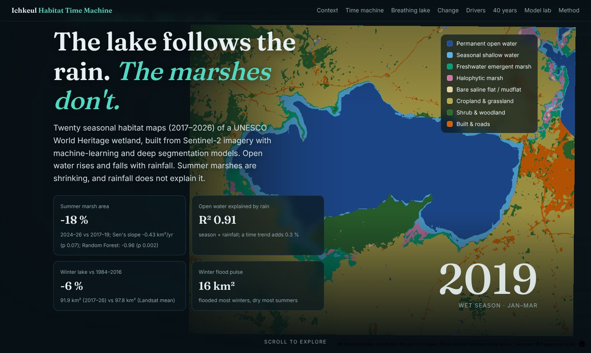
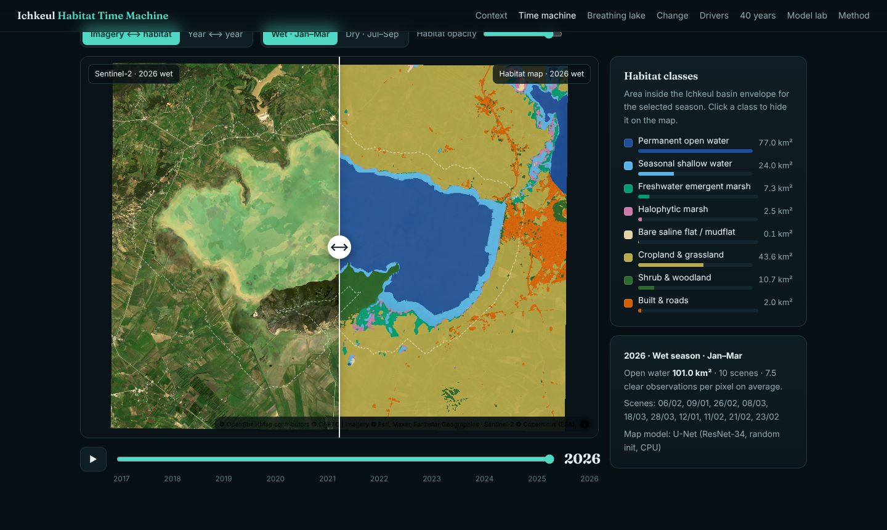

# Ichkeul Habitat Time Machine

**Seasonal wetland habitat maps of Ichkeul National Park (UNESCO World Heritage, Tunisia), 2017–2026, from Sentinel-2 with machine-learning and deep segmentation models (Prithvi-EO-2.0 and TerraMind runs ready for GPU), with change analysis, driver attribution and an interactive website.**

**Live site:** https://emna-saada.github.io/ichkeul-habitat-time-machine/

| | Key results |
|---|---|
| **-18 %** | Summer marsh area — 2024–26 vs 2017–19; Sen's slope -0.43 km²/yr (p 0.07); Random Forest: -0.96 (p 0.002) |
| **R² 0.91** | Open water explained by rain — season + rainfall; a time trend adds 0.3 % |
| **-6 %** | Winter lake vs 1984–2016 — 91.9 km² (2017–26) vs 97.8 km² (Landsat mean) |
| **16 km²** | Winter flood pulse — flooded most winters, dry most summers |




## Why Ichkeul

Lake Ichkeul is the last freshwater–brackish lake of a chain that once crossed North Africa. It is a Ramsar site (no. 213) and World Heritage property. It was on the List of World Heritage in Danger from 1996 to 2006, after dams on its rivers cut the freshwater supply. Wintering waterbirds collapsed from a 2008 peak near 300,000 to fewer than 6,000 in January 2020. This project asks four questions:

1. Do geospatial foundation models (Prithvi-EO-2.0, TerraMind) beat a Random Forest, an AlphaEarth-embedding Random Forest and a U-Net when labels are scarce and weak?
2. How have open water, freshwater marsh, halophytic marsh and saline flats changed between 2017 and 2026, season by season?
3. How much of that change follows rainfall, and how much is left over for upstream water capture and management?
4. How does the last decade sit in the 40-year Landsat record that starts before the dams?

## Method in one picture

```
Sentinel-2 L2A (2017-2026)  ──► cloud-masked wet (Jan-Mar) / dry (Jul-Sep) medians ──► 20 composites, 10 m
WorldCover + JRC water + DEM + seasonal NDVI/MNDWI rules ──► weak labels (8 classes, ~85 % of pixels)
224 px chips, 80 locations, spatial-block split 56/12/12 ──► RF (indices) · RF (AlphaEarth) · U-Net · Prithvi-EO-2.0 · TerraMind
best model ──► 20 habitat maps ──► areas, Mann-Kendall / Sen, transitions, inundation frequency
PERSIANN-CDR rainfall ──► OLS unique R², gradient boosting + SHAP      Landsat 1984-2021 ──► 40-year water series
```

## Results

**Models** (test chips at 12 held-out locations × 20 seasons, scored against weak labels, 100 % of training chips):

| Model | mIoU | Overall accuracy | Macro F1 | Seeds |
|---|---|---|---|---|
| U-Net (ResNet-34, random init, CPU) | 0.573 ± 0.000 | 95.5 % | 0.686 | 1 |
| Random Forest · spectral indices | 0.514 ± 0.000 | 91.3 % | 0.626 | 3 |


**Change, 2017-2026** (basin envelope, 167 km²; Sen's slope km²/yr and Mann-Kendall p, on each classifier's maps):

| Map model | Summer marsh | Summer open water | Winter open water |
|---|---|---|---|
| Random Forest · spectral indices | -0.96 (p 0.002) | -0.20 (p 0.858) | -0.66 (p 0.283) |
| U-Net (ResNet-34, random init, CPU) | -0.43 (p 0.074) | -0.22 (p 0.721) | -0.50 (p 0.371) |

**Drivers.** Season plus rainfall explain R² = 0.91 of open-water area, and a time trend adds 0.3 %. Rainfall explains almost none of the marsh variation. The 40-year Landsat series agrees with Sentinel-2 at r = 0.99.

Full write-up with methods, tables and limitations: [`results/REPORT.md`](results/REPORT.md).



## What is in this repository

```
configs/project.yaml       study grid, seasons, classes, split
src/ichkeul/
  s2.py                    Sentinel-2 access (AWS COGs + Google Cloud SAFE fallback), cloud masking, seasonal medians
  aux.py                   WorldCover, JRC water, DEM, AlphaEarth embeddings, PERSIANN-CDR rainfall
  labels.py                weak-label rules (agreement of independent sources)
  chips.py                 224 px chips, spatial-block split, GPU dataset folder
  baselines.py             Random Forest on indices / on AlphaEarth embeddings
  landsat.py               Landsat 5/7/8 seasonal MNDWI, 1984-2021
  analysis.py              areas, Mann-Kendall/Sen, transitions, inundation, drivers, side analyses
  gold.py                  stratified gold sample + Olofsson error-adjusted areas
  select_model.py          picks the map model from test scores
  export.py / report.py    website assets and results/REPORT.md, all numbers read from results/
  kaggle_run.py            Kaggle CLI driver for the GPU experiments
kaggle/train_gpu.py        U-Net, Prithvi-EO-2.0 (fine-tuned / frozen / 3 dates), TerraMind; fractions x seeds
notebooks/                 Colab version of the GPU run
results/                   metrics, analysis.json, REPORT.md
web/                       Vite + MapLibre + ECharts site, gold-labelling tool (label.html)
tests/                     pytest for indices, metrics, statistics, shared split rule
```

## Reproduce

```bash
uv sync                      # Python 3.12+, pinned dependencies
make data                    # composites 2017-2026, auxiliary layers, Landsat (cached, ~6 GB)
make labels                  # weak labels + chips
make baselines               # Random Forest baselines (CPU)
# GPU experiments: set KAGGLE_USERNAME / KAGGLE_KEY, then
make gpu-upload gpu-push gpu-wait gpu-fetch
make analysis web            # change analysis, website build
make gold-sample             # then label in web/label.html and run: make gold-score
make test
```

No account is needed for any data source: Sentinel-2 and Landsat come from public cloud buckets, and AlphaEarth embeddings from Google's public GeoTIFF bucket. Only the GPU step needs a Kaggle (or Colab) account.

## Data and licences

Contains modified Copernicus Sentinel data 2017–2026 (ESA). ESA WorldCover 2020/2021 (CC BY 4.0); JRC Global Surface Water v1.4 (EC JRC); Copernicus DEM GLO-30; AlphaEarth Foundations satellite embeddings (Google, CC BY 4.0); PERSIANN-CDR (NOAA CDR program); Landsat 5/7/8 (USGS, public domain); Prithvi-EO-2.0 and TerraMind weights (Apache 2.0). Basemap imagery on the website © Esri and partners; labels © OpenStreetMap contributors, © CARTO. Context figures (timeline, waterbird numbers) are cited on the site.

## Author

**Emna Saada**, geoinformatics engineering student, Bizerte, Tunisia · [GitHub](https://github.com/emna-saada)

Code released under the MIT licence.
